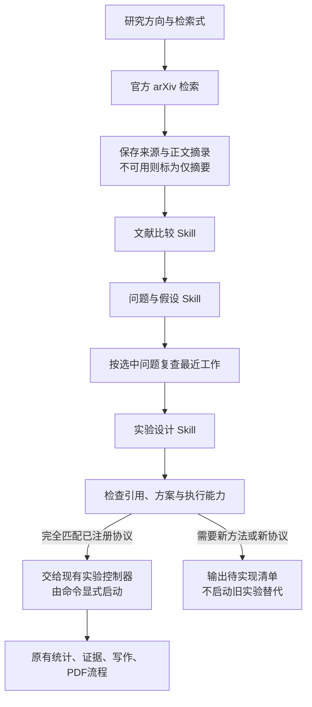

# 文献 → 问题 → 实验：已实现流程

本轮补齐固定实验之前的研究步骤。仓库内 `research/skills/` 有三个可移植的 Markdown Skill：文献阅读比较、问题与假设、实验设计。每次模型调用前真实读取对应 Skill，文件哈希进入 manifest。它们通过现有 ModelGateway 调用已配置模型，不依赖开发者个人 Skill 目录或另一套 API Key。



## 运行

```powershell
.venv/Scripts/python.exe -m research.discovery --topic "Agent记忆中的时间更新与冲突" --query "ti:LongMemEval OR ti:Mem0 OR (ti:Agentic AND ti:Memory)" --paper-limit 4 --output output/discovery_new --max-total-tokens 60000
```

此命令检索真实外部文献并产生最多三次模型调用；准入 token 上限不是供应商计费硬上限。每次请求提前写账，实际响应先持久化再解析。失败不自动重试；未知用量停止。只使用既有私有模型配置，可传 `--config-dir`。检索采用 [arXiv 官方 API](https://info.arxiv.org/help/api/user-manual.html)，串行间隔至少 3.1 秒，单次超时 25 秒，结果数最多 12，单页面最多 6MB，正文摘录每篇最多 8000 字符。当前仅支持 arXiv，不能称为全面或系统性综述。

结果包括：`sources.json`（来源、阅读范围、哈希、片段定位）、三个 Skill 的 JSON、`closest_work.json`、`handoff.json`、中文 `REPORT.md`、`state.json` 及请求/响应账本。完成时检查产物哈希；同参数恢复复用已计账响应，修改研究输入、实现或 Skill 则要求新目录。只有来源编号和引文可以机械核对；解释是否正确、问题是否值得研究仍需审读。最近工作检索结果尚未逐篇完整阅读，不能宣布创新。

## 接入实验

`handoff.status=registered_protocol_ready` 才可使用现有 `structured-memory-v1` 适配器。它仅支持原本固定的 6 开发/24 留出任务、256/512 上下文预算、八种方法和固定数据种子；方案中的协议必须逐项一致，调用上限必须为 700，运行 token 上限必须与方案一致。该适配器用于复现和检验有限的既有问题，不会实现模型提出的新算法。

```powershell
.venv/Scripts/python.exe -m research.orchestrator --discovery-dir output/discovery_new --run-dir output/new_memory_run --paper-dir output/new_memory_paper --max-total-tokens 100000
```

示例的 100000 必须替换为方案实际登记的预算。这个命令会产生新的实验和写稿费用。新流程保存实际 ResearchBrief/ExperimentPlan，附到证据和写稿输入；旧实验不能事后换成另一套研究理由。新检索、新 reader、新数据或新的装包策略都必须先实现对应实验，不能通过改变自然语言描述来绕过边界。论文模板仍专用于结构化记忆研究，不是任意选题写作器。

## 本轮真实验证

`output/discovery_20261106` 保存原始三次 DeepSeek 响应：34,531 个实际 API tokens、没有未知用量；四篇论文为 Mem0、LongMemEval-V2、Spatial Memory by Agents for Agents、Executable Agentic Memory for GUI Agent。其中三篇取得正文摘录，一篇仅摘要。选择的问题围绕如何区分时间更新处理的收益与一般检索改善；这只是候选假设。

第三步方案引用了最近工作检索新找到的真实论文，首版检查器错误地只允许最初四篇 ID，故停止。修正检查范围后，通过下面命令在新目录**离线重校验原响应**，没有重新请求模型、改变原始评审或原实验：

```powershell
.venv/Scripts/python.exe -m research.discovery_revalidate --source output/discovery_20261106 --output output/discovery_20261106_validated
```

新目录 manifest 保存原始输入与响应文件哈希、校验器版本；state 区分原三次调用的累计成本与本次零新增模型调用。原目录仍保留当时停止的状态。生成方案为 `implementation_required`，尚未执行实验；模型提出的 200 万 token 实验预算是待评估提案，不是批准额度或本次消耗。方案还存在需人工核查的机制描述、样本量与显著性表述，不能直接当作可靠科研结论。

## 工作台

新增“文献与选题”页面（`#discovery`），只读展示研究来源、笔记、候选问题、最近工作和实验方案；没有启动付费流程的按钮。普通刷新也不会调用模型。当前会话启动的新服务为 `http://127.0.0.1:8766/#discovery`，原有 8765 服务没有被停止。正常启动仍使用 `scripts/start_workbench.ps1`。

## 验证

新测试覆盖原文引文、缺失全文、假引用、问题与方案关联、协议不匹配、产物篡改、离线重校验和只读工作台边界。浏览器验证使用真实 API，检查桌面、390px 和 320px 页面无横向溢出。旧论文分数和比赛成绩不继承到新方案。

本次最终验证：18 项新增专项测试通过；全量 211 项测试通过；前端 TypeScript/Vite 构建通过；真实浏览器桌面、390px、320px 检查通过。
