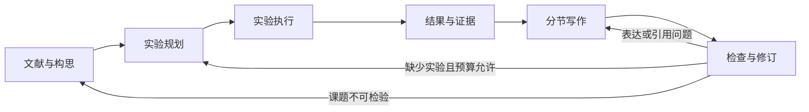

# 科研 Agent 第二版框架设计

2026-10-16 实施更新：已按本文实现固定课题的有限闭环与新的版本记忆 Rail，完成实际比较、独立复算、写稿、源码事实校正和 PDF。最新运行与交付见 [优化版记录](memory_release_20261016.md)。研究构思采用经核验的人工种子文献与已批准假设，未实现任意课题的自主创新或无限补实验循环；下文仍为最初目标设计。

日期：2026-10-11。状态：根据两个作者仓库源码形成的设计提案，尚未实现或运行第二版系统。已有能力以 baseline/ 为准；本文的文件名、接口和预算是拟定规格。代码审计及固定版本见 [复用审计](../sources/research_system_code_audit_2026-10-11.md)。

实施进展：同日已实现第一个离线里程碑——历史实验→可追溯证据→确定性报告，入口与边界见 [research/README.md](../research/README.md)。下文整体仍是目标架构；六模块与新记忆机制尚未全部实现。优化优先级按 [比赛评分表](competition_optimization_scorecard.md) 跟踪。

## 目标与边界

在现有 openJiuwen/JiuwenSwarm 基础上完成“可验证课题→固定实验协议→真实执行→证据→论文→补证据”的闭环。已有模型调用、用量日志、分析脚本和论文生成可复用；新增重点是模块间可追溯的交接和针对证据缺口的实验决策。

系统分为两层：外层六模块负责科研流程；内层记忆机制是它研究的课题。科研编排的改进和记忆算法的改进分别评价，避免把“组合多个 Agent”直接称为算法创新。

## 六模块与交接契约

模块交接保存 JSON，并引用大文件而不是把所有历史塞进提示词。所有对象共有 schema_version、artifact_id、parent_ids、created_at 和内容哈希；代码/数据/模型版本记录在对应产物中。秘密配置不写入产物。

| 模块 | 输入 | 输出与最小字段 | 进入下一阶段的条件 |
|---|---|---|---|
| 文献与构思 | 用户课题、核验后的论文与仓库 | ResearchBrief：question、hypothesis、closest_work、source_ids、difference、falsification、feasibility | 每项既有方法可追溯；假设能被实验反驳；“新颖性”标为待核查 |
| 实验规划 | ResearchBrief、资源限制、可用数据 | ExperimentPlan：dataset_version、split、methods、budget_policy、metrics、seeds、ablations、acceptance、commands | 数据与指标明确；比较预算对齐；开发/留出划分固定；命令和总预算可执行 |
| 实验执行 | 已校验 ExperimentPlan | RunManifest：plan_hash、code_revision、dirty_patch_hash、model_id、call_ids、raw_results、usage、status、errors | 原始结果和日志已落盘；失败/缺失不能冒充成功；超时或预算耗尽停止 |
| 结果与证据 | RunManifest、原始输出、标签与指标协议 | EvidenceBundle：metric_rows、intervals、figure_paths、failures、claim_ids、run_refs、limitations | 确认配置/结果/调用关联、样本完整；统计由脚本计算；缺失用量明确标记 |
| 分节写作 | ResearchBrief、Plan、EvidenceBundle、核验引用 | ManuscriptBundle：sections、claim_links、citation_links、table_refs、draft_version | 方法→结果→相关工作→引言→讨论/结论→摘要；数字表格由程序插入；各节保留原稿和修订稿 |
| 检查与修订 | ManuscriptBundle、证据、检查日志 | ReviewDecision：issue_type、severity、claim_id、evidence_gap、action、cost_estimate、stop_reason | 先通过机械检查；再评估论证；分流为 edit、fix_citation、rerun、add_experiment、stop |

最小 claim 条目为 claim_id、statement、evidence_ids、scope、status。status 使用 supported、unsupported、contradicted、inconclusive；不利结果同样入库。描述性判断如“更鲁棒”也必须绑定对应测试条件，不能仅验证表里的数字。

## 编排、模型与预算

六模块是职责划分，不要求六个常驻 Agent。文献理解、规划、写作和论证审查使用受限模型调用；命令执行、统计、数字校验、引用元数据核验和格式检查尽量用确定性程序。模型网关继续使用我们现有 openJiuwen 配置入口，不另建 DeepSeek 密钥配置。

拟定首轮工程限制：单个请求失败最多重试两次；每节最多两轮局部修订；实验计划最多一次补实验回退。所有嵌套调用都受全局请求数、输入/输出 token、墙钟时间预算约束；具体付费 token 总额在运行配置中显式提供，缺失则不启动批量调用。请求前预估与预留输出，完成后用实际 provider usage 对账；无法获取真实 usage 的调用不能记为零成本。供应商价格与 token 用量分开，价格应有来源及日期。

运行状态为 pending、running、succeeded、failed、budget_exhausted。检查点仅在产物校验通过后标记 succeeded；中断恢复使用产物哈希，模型/数据/代码/提示词变化会让相关缓存失效。调用失败不重复记作已完成样本，失败重试费用也计入总账。总预算包含检索、摘要、研究规划、写作和审查，另单独报告回答任务的实验成本。

首版只允许执行注册好的实验入口，并固定工作目录、配置、超时和输出清单。后续若需要 Agent 自动生成实验代码，再单独加入隔离执行环境；不直接移植参考系统的任意 exec 或整套 Docker/GPU流程。

## 第一项研究课题：更新与冲突下的预算受限记忆

这是待验证的候选方向，尚未认定原创。当前小型 baseline 的精确 ID 检索优势不足以支持复杂记忆结论，第二版应研究历史事实更新、旧事实冲突和同义改写时，如何在有限上下文中给出有证据的正确回答。

内层拟分为：记录摄取→带时间/来源的事实存储→候选检索→冲突与预算处理→回答及证据核验。首个机制候选是“版本与冲突感知的证据选择”：保留新旧记录关系，回答当前事实时优先有效版本，回答历史事实时遵守时间范围。复杂语义摄取和学习式检索先作为后续选项，以便清楚测出机制贡献。

必须比较的条件：全历史、最近窗口、同预算词法检索、可用时加入语义检索、检索后摘要、候选版本机制；全历史另列为非同预算参照。摘要和摄取的额外调用成本一起统计。实验覆盖静态事实、事实更新、矛盾记录、同义问题、无答案和干扰强度，并做去版本信息/去冲突处理的消融。

开发集用于选择机制与参数，留出集固定且不参与改进循环。先做小规模可复现试验确认日志与指标，再扩展数据和随机种子。主要指标：准确率、过期事实采纳率、证据支持率、应拒答时的拒答质量、API token 与耗时。统计方法和有效样本单元在计划阶段写定；没有足够独立样本时不声称显著改善。

外层框架另做“单次生成 vs. 固定检查修订 vs. 证据驱动补实验”的同预算比较，观察无证据陈述、数字/引用错误、重跑一致性和成本。不能用单个 AI 评审分数作为唯一实验目标。

## 分阶段落地清单

| 顺序 | 拟建文件 | 完成判据 |
|---|---|---|
| 1 | research/contracts.py、artifacts.py | 六类契约、哈希、谱系和检查点；旧 baseline 结果能够导入，旧结果只标记为历史证据 |
| 2 | research/model_gateway.py、runner.py、orchestrator.py | 抽取已有运行机制；固定实验命令；中断恢复和全局预算；原 baseline 可作为回归任务 |
| 3 | research/evidence.py、reviewer.py | 每张表与每条数字关联 run；故意篡改数字或遗漏样本能被检查器识别；补实验有明确缺口 |
| 4 | research/writer.py | 按章节依赖写作；数字由程序填充；输入证据变更只重建受影响章节；模板适配当前提交要求 |
| 5 | 新任务生成器与记忆 Rail | 更新/冲突/改写任务，预算匹配比较与消融；通过留出测试才进入新稿 |

首个实现里程碑是“旧实验证据→可追溯论文”的最小链条，验证交接后再实现新的记忆机制。不会把当前旧成绩包装为新方法结果。参考机制、复制代码和原创实现分别登记；真正的贡献由上述消融与留出实验支持。
