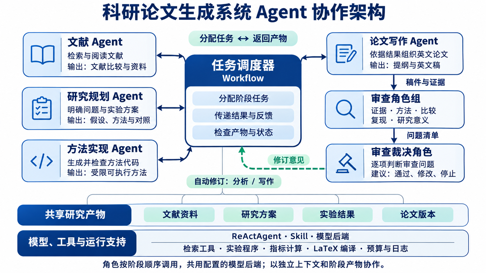

# 第6组项目汇报逐页稿

项目：基于 JiuwenSwarm 的 Agent 科研论文自动生成系统  
课程：大数据项目实践  
版本：讨论稿，先修改内容，再制作 PPT  
篇幅：暂定 16 页，汇报时间约 12—15 分钟

本文每页分为“页面内容”和“讲稿”。页面内容是未来 PPT 上保留的信息；讲稿是汇报时实际说的话，可以直接修改。暂不制作 PPT。

## 第1页 封面

### 页面内容

**基于 JiuwenSwarm 的 Agent 科研论文自动生成系统**

大数据项目实践 · 第6组

| 姓名 | 学号 |
|---|---|
| 金若曦 | 102402127 |
| 洪豊幀 | 102402124 |
| 黄炜杰 | 102402126 |
| 黄俊翔 | 102402125 |
| 王智洋 | 102402136 |

### 讲稿

老师好，我们是第6组。本次项目围绕科研论文自动生成赛题展开，使用 JiuwenSwarm 开发了一套 Agent 系统。

下面先介绍赛题背景和我们对赛题的理解，再介绍系统设计、具体实现和实验结果。

## 第2页 赛题背景与任务

### 页面内容

**赛题背景与任务**

科研论文的形成涉及：

文献调研 → 提出问题 → 设计方法 → 执行实验 → 分析结果 → 写作与修改

本项目需要围绕这些工作开发 Agent 系统，形成论文，并提交源码、设计说明和相关材料。

### 讲稿

这个赛题以科研论文生成为任务场景，要求我们利用 Agent 完成相关研究工作，并形成论文。

写论文之前，需要查阅已有工作、确定研究问题、设计方法、运行实验，再根据结果进行分析。这些工作涉及不同工具，也有先后依赖。例如，实验方案改变以后，后面的结果和论文内容也需要更新。

因此，系统需要考虑整个研究过程怎样执行，以及各个步骤之间怎样传递信息。

## 第3页 赛题的评价要求

### 页面内容

**赛题怎样评价我们的系统**

| 评价维度 | 分值 | 评分依据 |
|---|---:|---|
| 论文质量 | 60 | Stanford Agentic Reviewer 40分，论文评测 Agent 20分 |
| Agent 系统能力 | 15 | Agent 源码与设计文档 |
| 资源消耗 | 10 | 资源和成本相关设计、资源报告 |
| openJiuwen 贡献 | 15 | 代码、Skill、文档、PR链接或补丁等 |

### 讲稿

赛题主要从这四个方面评分，其中论文质量占60分，是分值最高的部分。

根据这些要求，我们需要设计一套能够实际运行的 Agent 系统，准备清楚、可用的设计文档，并按要求提供源码，让评审能够了解系统的结构和实现。

这套系统还需要生成质量较好的论文，包括合理的研究问题、实验设计和结果分析。同时，要考虑模型调用的 Token 消耗和成本，记录实际用量。对于 openJiuwen，也需要提供具体的代码改进、Skill、文档或补丁。

这些要求决定了我们既要做好系统，也要验证它实际生成的研究成果。

## 第4页 我们对赛题的理解

### 页面内容

**我们认为需要解决的三个问题**

1. 怎样把一个研究方向变成可以执行的研究任务？
2. 怎样让 Agent 使用工具完成实验，并把结果交给后续步骤？
3. 怎样让生成的论文有实验依据，并通过审查继续改进？

### 讲稿

我们把赛题理解为三个相互关联的问题。

第一个是研究任务的形成。用户给出的通常是一个方向，系统要进一步明确研究什么、与谁比较、用什么实验验证。

第二个是任务执行。方案确定以后，需要调用实际工具完成实现和实验，得到可以检查的结果。

第三个是论文质量。写作需要依据这些结果，审查发现问题后，还要能够修改分析或正文，必要时重新开展前面的工作。

所以，我们决定按照研究过程划分模块，用一个统一的工作流把它们组织起来。

## 第5页 系统整体设计

### 页面内容

**Agent角色与协作架构**

中心：任务调度器，根据当前阶段选择执行角色，向其提供前序产物和修改意见，接收结果并判断下一步。

围绕调度器展示六类Agent角色：

| 角色 | 负责的工作 | 交给其他角色的结果 |
|---|---|---|
| 文献Agent | 检索、阅读和比较已有工作 | 文献资料与比较记录 |
| 研究规划Agent | 提出可检验的问题，确定方法和实验对照 | 研究问题与实验方案 |
| 方法实现Agent | 在已支持的任务范围内生成方法代码并检查 | 可执行方法与检查结果 |
| 论文写作Agent | 根据研究方案和分析结果组织英文论文 | 论文提纲与英文稿 |
| 审查角色组 | 从证据、方法、比较、复现、意义五个角度检查 | 审查问题与修订建议 |
| 审查裁决角色 | 逐项判断问题，给出通过、修改或停止的建议 | 裁决与修改目标 |

共同依赖：模型后端、阶段产物、按阶段配置的工具与Skill。

图中将实验执行与指标计算画成工具或服务，由调度器按阶段调用；不将所有程序模块都标成Agent。

### 讲稿

这一页主要介绍系统中有哪些Agent角色，以及它们怎样协作。

任务调度器负责安排执行顺序。文献Agent先整理已有工作，研究规划Agent据此提出问题并形成方案，方法实现Agent完成当前任务支持的方法实现。实验程序运行以后，分析服务计算结果，论文写作Agent再读取这些材料生成英文稿。

初稿交给审查角色组，从五个角度提出问题，再由裁决角色逐项处理。需要修改时，调度器把问题和相关材料交回对应阶段。

这些角色通过保存的阶段产物传递信息。当前主要使用同一个模型后端，按阶段和独立上下文承担不同角色；调度器负责流程控制，实验和统计由实际程序执行。

## 第6页 模块分工与 Agent 执行

### 页面内容

**一个Agent角色怎样完成自己的任务**

角色配置：职责提示、输入材料、输出格式、阶段适用Skill。

执行过程：接收任务 → 调用模型或已注册工具 → 检查返回结果 → 保存产物。

职责边界：

- 调度器管理阶段和依赖。
- Agent角色承担需要模型判断和生成的工作。
- 工具和服务负责检索、实验、指标计算与编译。
- 预算与日志模块记录调用和实际用量。

### 讲稿

每个角色都有自己的任务提示、输入材料和输出要求，并按阶段加载需要的Skill。模型调用通过真实的ReActAgent执行，返回内容还要经过程序检查才能交给下一阶段。

工具调用有两种连接方式：通用执行器允许模型请求已注册工具；当前接通的研究流程也会由阶段处理程序直接调用检索、实验和分析服务。

例如，模型可以提出当前支持的文档选择方法，程序检查代码并执行实验，指标由分析服务计算，写作角色再解释结果。这个分工需要在架构图中画清楚。

## 第7页 一次任务的完整过程

### 页面内容

**案例 Agent 怎样利用长历史中的信息**

| 步骤 | 本案例的内容 |
|---|---|
| 研究方向 | 长历史中的信息利用 |
| 具体问题 | 只保留最近信息是否会遗漏回答所需内容 |
| 实验方案 | 比较全量、最近窗口、检索、检索加摘要 |
| 评价指标 | 回答正确率、模型调用消耗 |
| 输出 | 实验结果、分析图表、英文论文 |

### 讲稿

下面用我们已经完成的一项研究，说明这些模块怎样配合。

最初的方向是 Agent 对长历史的利用。我们把它落实为一个具体问题：历史较长、上下文有限时，只保留最近的信息，是否会遗漏回答问题所需要的内容？

围绕这个问题，我们比较四种策略，使用相同的任务检查回答正确率，同时记录调用消耗。实验结束后，系统汇总结果，生成图表，再进入英文写作。

接下来介绍这个案例中两项比较重要的实现。

## 第8页 上下文信息怎样选择

### 页面内容

**给模型提供相关且完整的信息**

- 文本资料：关键词检索、向量检索、融合排序。
- 结构化记忆：按事实生效时间和系统获知时间筛选。
- 冲突记录：同时生效的矛盾信息作为一组保留。
- 预算控制：选择后重新计算长度，超出预算时整组移除。

示例：同一时刻的两条记录分别写着“上海”和“杭州”，需要让模型看到两条记录及其冲突。

### 讲稿

第一项是上下文选择。资料很多时，需要先找出与当前问题相关的内容，再交给模型。

系统对文本资料提供关键词、向量和融合检索。对于带版本的结构化记忆，还要区分事实何时生效、系统何时获知，防止把后来才知道的信息用到过去的问题中。

另外，如果两条同时生效的记录给出不同答案，我们把它们作为一组保留。否则，只留下其中一条，模型可能就无法发现信息有冲突。上下文预算不足时，也按完整的组进行取舍。

## 第9页 实验结果怎样进入论文

### 页面内容

**论文中的数字需要有对应来源**

原始回答与日志 → 结果汇总 → 指标计算 → 图表 → 英文正文

示例：

60个正确回答 ÷ 72个任务 = 83.33%

同时保存模型、实验条件、结果文件位置和文件版本。

### 讲稿

第二项是实验结果与论文的连接。

系统先保存原始回答，再汇总计数，由程序计算指标和生成图表，写作模型根据这些结果组织解释。

例如，论文中的83.33%，应当能够找到对应的60个正确回答和72个任务，还要知道它来自哪个模型、哪种方法和哪个预算条件。

我们保存这些来源和版本信息，便于修改时检查数据是否一致。这样也能减少模型写错数字，或者把不同实验的结果混在一起的问题。

## 第10页 论文写作与审查

### 页面内容

**从实验结果生成英文稿 再检查与修改**

写作输入：研究问题、方法、文献、结果与图表。

审查内容：

- 结论是否有证据支持
- 方法实现和实验对照是否合理
- 结果是否能够复算
- 论文是否夸大了实验结论

输出：英文稿、审查问题、修订记录、LaTeX与PDF。

### 讲稿

写作模块读取研究方案、文献和分析结果，生成英文稿，再通过 LaTeX 编译成 PDF。工作台使用中文，论文使用英文。

初稿完成以后，系统会检查证据、方法、比较和可复现性等方面的问题，再逐项处理。当前自动修改主要覆盖分析和写作；涉及方案或实验实现的问题，需要显式重新打开对应阶段。

这一部分直接影响论文质量。流程可以帮助发现错误，但选题是否有价值、实验是否充分，还需要结合具体研究判断。

## 第11页 工作台与任务管理

### 页面内容

**在工作台查看任务进展和研究产物**

配工作台截图，标注：

- 当前研究阶段
- 实验结果与分析
- 模型调用和资源记录
- 英文论文与PDF

修改和恢复：

- 只改文字，可以保留实验。
- 修改方案，需要更新受影响的后续结果。
- 任务中断，先核对已完成工作，再继续运行。

### 讲稿

工作台把各阶段的状态和产物集中展示出来，用户可以查看进度，也可以直接打开结果文件和论文。

研究过程经常会修改。如果只是调整文字，就不需要重新做实验；如果改变了实验方案，后面的实验、分析和论文就需要相应更新。系统会记录这些依赖关系。

运行中断时，也会保留已经完成的工作和调用记录，核对以后再继续，减少重复执行和重复付费。

## 第12页 基础实验结果

### 页面内容

**不同上下文策略的基础对比**

| 策略 | 正确回答 | API总Token |
|---|---:|---:|
| 全量历史 | 24/24 | 74,665 |
| 最近窗口 | 6/24 | 15,283 |
| 项目ID检索 | 24/24 | 4,212 |
| 检索加摘要 | 24/24 | 7,608 |

实验范围：24个合成任务，问题包含明确项目ID；全量历史不受同样的选择预算限制。

### 讲稿

这张表是最初的基础实验。

全量历史能答对全部问题，但使用的 Token 比较多。最近窗口只答对6个，原因是部分问题需要的信息已经不在保留范围内。按项目ID检索也答对全部问题，消耗更低。检索后再加摘要，在这组任务上没有提高正确率，还增加了消耗。

这组结果帮助我们检查基础流程，也促使我们继续研究信息选择。不过这些任务包含明确项目ID，比较有利于检索，因此还需要进一步验证。

## 第13页 进一步验证

### 页面内容

**改进效果受模型和任务条件影响**

72题受控测试：

| 条件 | Flash | Pro |
|---|---:|---:|
| 保留冲突，基础回答方式 | 60/72 | 72/72 |
| 保留冲突，加入冲突核验 | 72/72 | 72/72 |
| 删除部分冲突来源，加入核验 | 60/72 | 60/72 |

外部会话测试：关键词、向量和融合检索没有一致的优劣顺序。

### 讲稿

进一步的受控测试检查了冲突保留与核验。

Flash加入冲突核验后，正确数从60提高到72；Pro原本已经全部答对，没有额外提升。如果删除部分冲突来源，即使加入核验，两者也都只有60个正确回答。

我们还进行了外部会话测试，不同检索方法的表现没有形成一致排名，评价使用的是项目适配方式。

这些结果提醒我们，方法效果需要结合任务、模型和输入条件来解释。系统需要把没有提升和表现较差的结果也保存下来，写作时如实分析。

## 第14页 对照赛题要求检查成果

### 页面内容

**当前完成情况与不足**

| 赛题要求 | 当前成果 | 后续重点 |
|---|---|---|
| 论文质量 | 英文论文、实验、图表与审查记录 | 提升选题价值、方法贡献和实验广度 |
| Agent系统能力 | 调度、工具执行、任务恢复、工作台与设计材料 | 扩大可执行任务范围，完善文档 |
| 资源消耗 | 调用预算、用量记录和资源报告 | 比较不同方案的成本与效果 |
| openJiuwen贡献 | Rail扩展、测试、文档和本地补丁 | 整理可复用贡献，推进上游交流 |

### 讲稿

回到赛题要求，目前我们已经完成系统的主要流程，能够执行已接入的实验任务，生成英文论文，并提供代码、设计材料和运行记录。

资源方面，每次调用前检查预算，调用后记录实际用量。没有明确用量的调用单独登记，保留核对依据。框架方面，已经整理了 Rail 扩展、测试、文档和本地补丁。

当前最需要提升的仍然是论文质量，尤其是选题价值、方法贡献和实验说服力。系统还需要支持更多研究任务，文档和可复用的框架贡献也需要继续完善。

## 第15页 小组分工

### 页面内容

**成员分工与对应成果**

| 成员 | 负责内容 |
|---|---|
| 金若曦 102402127 | 使用说明书、课程报告、PPT、图表与汇报材料 |
| 洪豊幀 102402124 | 数据、任务生成、实验运行与结果复核 |
| 黄炜杰 102402126 | 证据整理、英文论文与LaTeX/PDF |
| 黄俊翔 102402125 | 测试、统计、日志关联与复现检查 |
| 王智洋 102402136 | 总体架构、JiuwenSwarm集成、运行时与配置 |

### 讲稿

小组按照模块进行分工。

王智洋负责总体架构和框架集成；洪豊幀负责数据与实验；黄炜杰负责证据整理和英文论文生成；黄俊翔负责测试、统计和复现检查；金若曦负责文档和汇报材料。

各部分通过共同的实验方案和文件格式连接。例如，实验输出结果文件，分析和写作读取这些结果，测试检查中间过程和最终产物是否一致。

## 第16页 总结与后续工作

### 页面内容

**项目总结与后续工作**

已经完成：

- 建立从研究问题到英文论文的工作流程。
- 接通实际模型、工具和实验程序。
- 保存研究结果、论文和模型调用之间的对应关系。

下一步：

- 提高选题和研究设计质量。
- 扩大实验与任务覆盖范围。
- 完善审查、人工修改和使用文档。

### 讲稿

围绕这次赛题，我们完成了一套科研论文生成系统，并通过实际案例运行了实验、分析和英文写作过程。系统可以保存各阶段产物，支持检查、修改和继续运行。

接下来，我们会重点改进选题和研究设计，增加实验支持范围，完善审查和人工修改功能，让系统生成的研究成果更可靠，也更方便使用。

以上是第6组的汇报，谢谢老师。

---

## 编辑备注

以下内容用于改稿，不进入PPT或口头讲稿。

- 汇报主线：赛题背景 → 评价要求 → 我们的理解 → 整体设计 → 执行案例 → 关键实现 → 实验验证 → 成果与分工。
- 记忆与检索属于具体研究案例，不应取代科研论文生成系统这个汇报主体。
- 论文质量、设计文档、源码和资源控制应讲清楚具体要求，避免只把评分维度换几个词再复述一遍。
- 正式讲稿中的“已完成”要与实际文件一致。源码公开地址及上游PR状态，在制作相应页面前核实；目前不写已经完成上游合并。
- 基础24题、受控72题和外部会话属于不同实验，不能合并分母或直接横向排名。
- 页数和讲述时间暂定。先修改叙事与内容，确定后再安排图表、截图和页面排版。
